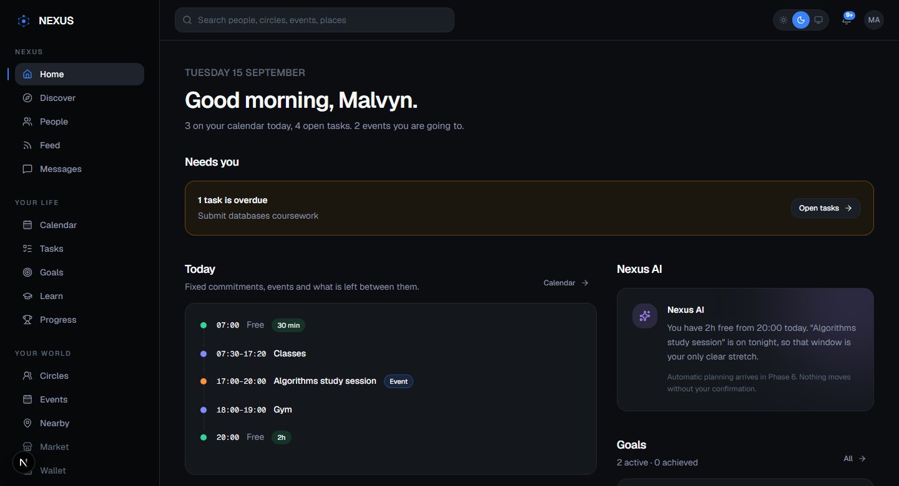
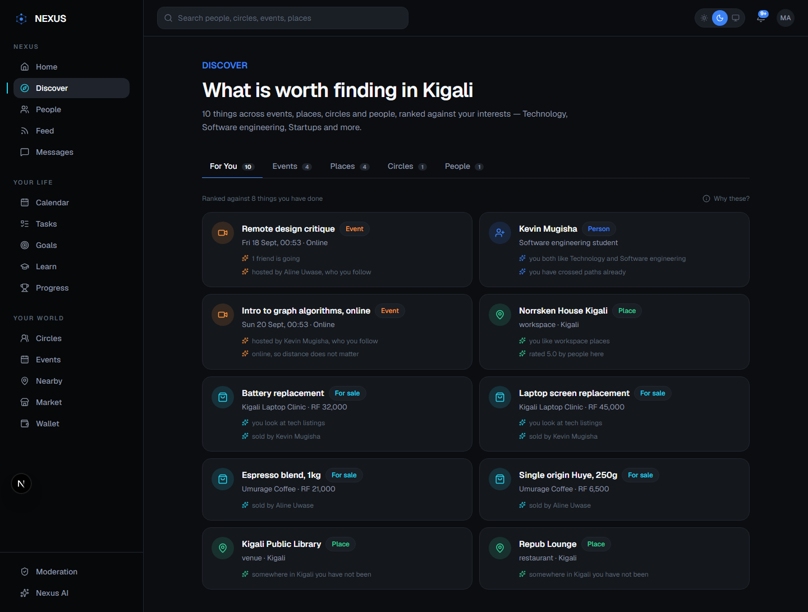
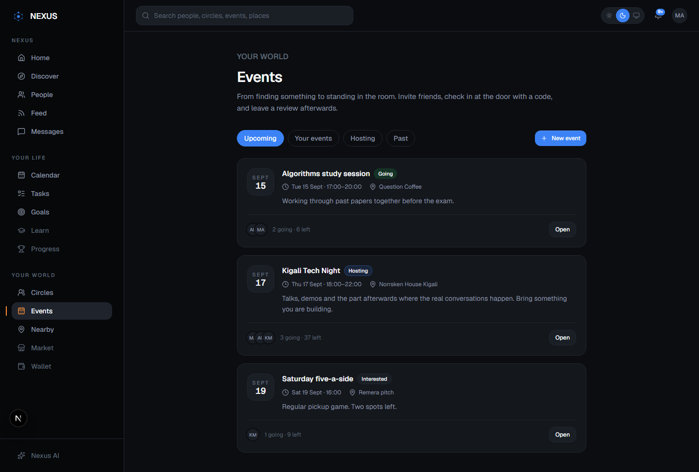
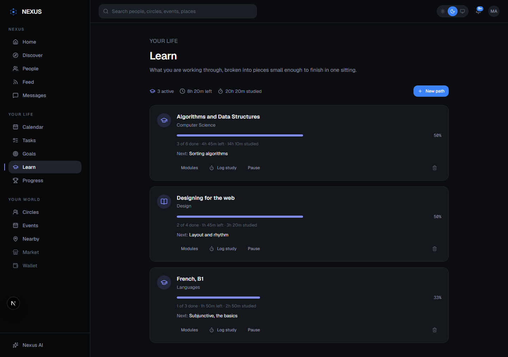
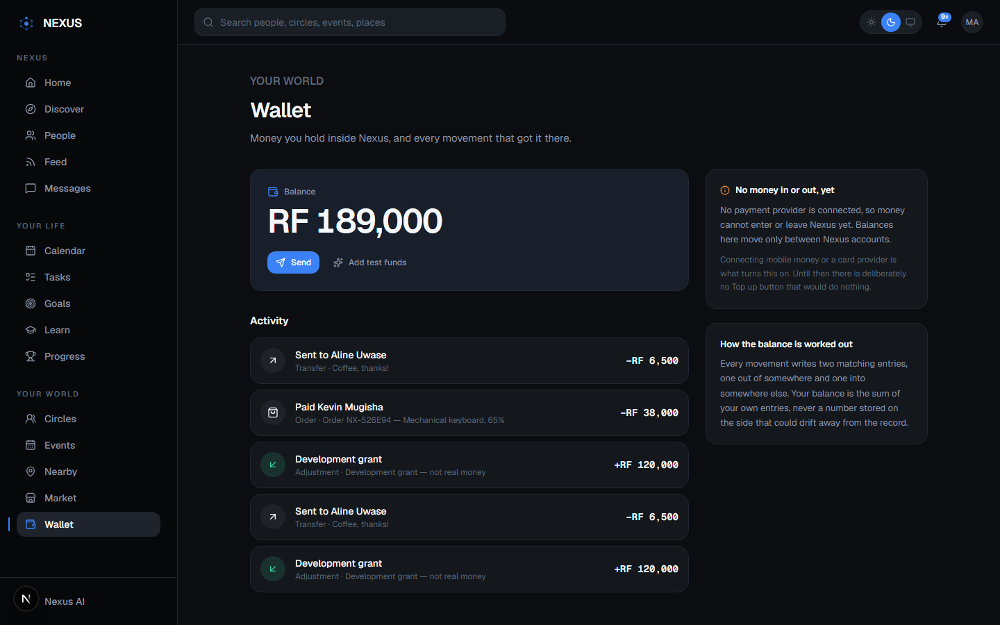

# NEXUS

**Your world. Your people. Your places. Your life.**

A personalized digital-world platform: people, places, communities, events, learning,
goals and planning connected through one interface.



## What it does

- **Home and Pulse**: your day at a glance, built from your real tasks, goals and events
- **People and Feed**: follows, friends, posts with visibility, polls, reactions, threaded comments
- **Circles**: public, private and invite-only communities with roles and live chat
- **Events and Nearby**: RSVPs, capacity, host check-in codes, and a live map of places
- **Planner**: tasks, goals with milestones, a calendar that finds your real free time
- **Learn and Progress**: learning paths, study streaks, a twelve-week heatmap, and Plan my day
- **Market and Wallet**: businesses, listings, orders, and a double-entry wallet
- **Discover**: recommendations that learn from what you do and say why
- **Admin**: moderation queue, suspensions, analytics, and a full audit trail

| | |
| --- | --- |
|  |  |
|  |  |

## Stack

| Layer | Choice |
| --- | --- |
| Web | Next.js 16 · React 19 · TypeScript · Tailwind v4 |
| API | NestJS 12 · TypeScript · ESM |
| Data | PostgreSQL 17 · Prisma |
| Cache / jobs | Redis 7 |
| Workspace | pnpm workspaces · Turborepo |

## Layout

```
apps/web        Next.js application
apps/api        NestJS API
packages/ui     Design system (tokens + primitives)
packages/db     Prisma schema, migrations, seed
packages/config Shared TypeScript configs
scripts/        shoot.mjs — headless Chrome visual QA
```

## Getting started

```bash
pnpm install
cp .env.example .env
pnpm db:up      # postgres on 5433, redis on 6380
pnpm --filter @nexus/db migrate   # apply migrations
pnpm --filter @nexus/db seed      # interest catalogue
pnpm dev        # web on 3000, api on 4000
```

On a machine short on memory, `pnpm lite` builds once and serves the compiled
app under capped heaps (about 270 MB for web and API together). Add
`--no-build` to skip the build on later runs.

Optional keys in `.env` switch on extra features:

| Key | Turns on |
| --- | --- |
| `RESEND_API_KEY` | Real verification and password-reset emails |
| `ANTHROPIC_API_KEY` | Claude-assisted day planning (falls back to rules without it) |

Verify the schema end to end:

```bash
pnpm --filter @nexus/db verify   # schema, constraints, cascades
node scripts/verify-auth.mjs     # full auth flow over HTTP (API must be running)
```

## Auth

Access tokens are short-lived JWTs in an httpOnly cookie. Refresh tokens are
opaque, stored only as a SHA-256 hash, and rotate on every use. Presenting an
already-rotated token is treated as a breach: every session for that user is
revoked immediately.

With `RESEND_API_KEY` set, verification and reset emails go out through Resend.
Without it, links are written to the API log by the dev mail transport, and
returned in the response body outside production.

Health check: `http://localhost:4000/api/v1/health`

## Verification

```bash
pnpm --filter @nexus/db verify   # schema: 11 checks
node scripts/verify-auth.mjs     # auth flow over HTTP: 29 checks
node scripts/verify-profile.mjs  # onboarding + profile: 20 checks
node scripts/verify-planner.mjs  # tasks, goals, calendar, notifications: 26 checks
node scripts/verify-social.mjs   # follows, friends, blocks, posts, feed: 40 checks
node scripts/verify-circles.mjs  # circles, roles, messaging, websockets: 38 checks
node scripts/verify-events.mjs   # places, distance, events, check-in: 42 checks
node scripts/verify-learning.mjs # learning, progress, day planning: 54 checks
node scripts/verify-market.mjs   # businesses, listings, orders, ledger: 79 checks
node scripts/verify-admin.mjs    # roles, moderation, suspension, analytics: 39 checks
node scripts/verify-discover.mjs # affinity, recommendations, opt-out: 30 checks
node scripts/shoot.mjs <url> <out.png> --width=390 --mobile=1
```

## Build phases

All nine phases are built: foundation and auth, planner, social, circles and
messaging, places and events, learning, marketplace and wallet, admin and
moderation, and personalization. The Nearby map uses MapLibre with OpenFreeMap
tiles, so it needs no map token.
